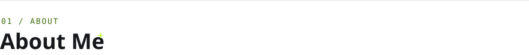
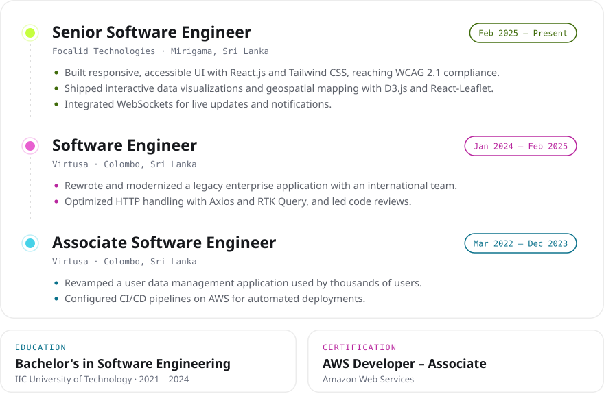
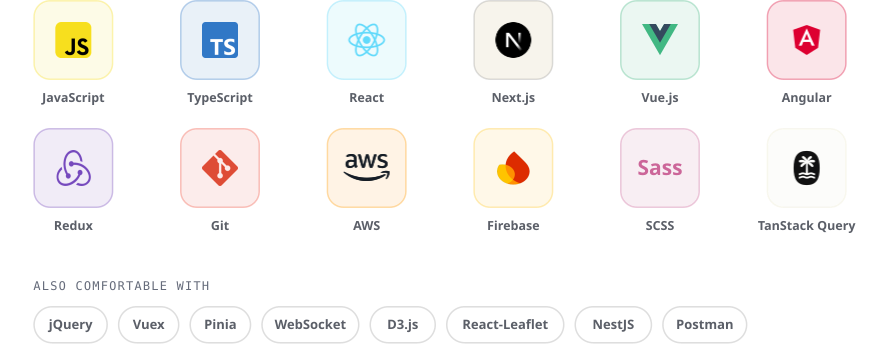
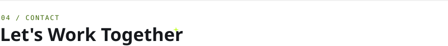

<!-- Images in assets/ are generated by scripts/render.mjs. -->

<a href="https://nilupulperera.dev">
  <picture>
    <source media="(prefers-color-scheme: dark)" srcset="assets/dark/header.svg">
    
  </picture>
</a>

  <a href="https://nilupulperera.dev" target="_blank" rel="noopener noreferrer"><picture><source media="(prefers-color-scheme: dark)" srcset="assets/dark/btn-portfolio.svg"></picture></a>
  <a href="https://linkedin.com/in/hasunnilupul" target="_blank" rel="noopener noreferrer"><picture><source media="(prefers-color-scheme: dark)" srcset="assets/dark/btn-linkedin.svg"></picture></a>
  <a href="https://nilupulperera.dev/assets/Nilupul-Perera-Resume.pdf" target="_blank" rel="noopener noreferrer"><picture><source media="(prefers-color-scheme: dark)" srcset="assets/dark/btn-resume.svg"></picture></a>

 

<picture>
  <source media="(prefers-color-scheme: dark)" srcset="assets/dark/title-about.svg">
  
</picture>

I'm Nilupul, a frontend-focused **Senior Software Engineer** who enjoys turning complex requirements into fast, accessible interfaces. I've spent **4+ years** building production React, Next.js, Vue and Angular applications — from WCAG-compliant UI kits to real-time, WebSocket-driven dashboards and geospatial data visualizations.

- 🛠️ &nbsp;Currently a Senior Software Engineer at **Focalid Technologies**, Sri Lanka
- ☁️ &nbsp;**AWS Certified Developer – Associate**
- ✍️ &nbsp;I write on [Medium](https://hasunnilupul.medium.com/) and [DEV](https://dev.to/hasunnilupul)
- 💬 &nbsp;Ask me about **React, Next.js, Vue, TypeScript, accessibility and real-time UIs**

 

<picture>
  <source media="(prefers-color-scheme: dark)" srcset="assets/dark/title-experience.svg">
  
</picture>

<picture>
  <source media="(prefers-color-scheme: dark)" srcset="assets/dark/experience.svg">
  
</picture>

  

<picture>
  <source media="(prefers-color-scheme: dark)" srcset="assets/dark/title-stack.svg">
  
</picture>

<picture>
  <source media="(prefers-color-scheme: dark)" srcset="assets/dark/stack.svg">
  
</picture>

  

<picture>
  <source media="(prefers-color-scheme: dark)" srcset="assets/dark/title-connect.svg">
  
</picture>

Got a project, a role or just want to say hi? My inbox is open.

  <a href="https://nilupulperera.dev" target="_blank" rel="noopener noreferrer"><picture><source media="(prefers-color-scheme: dark)" srcset="assets/dark/btn-portfolio.svg"></picture></a>
  <a href="mailto:nilupulpere@gmail.com" target="_blank" rel="noopener noreferrer"><picture><source media="(prefers-color-scheme: dark)" srcset="assets/dark/btn-email.svg"></picture></a>
  <a href="https://linkedin.com/in/hasunnilupul" target="_blank" rel="noopener noreferrer"><picture><source media="(prefers-color-scheme: dark)" srcset="assets/dark/btn-linkedin.svg"></picture></a>
  <a href="https://hasunnilupul.medium.com/" target="_blank" rel="noopener noreferrer"><picture><source media="(prefers-color-scheme: dark)" srcset="assets/dark/btn-medium.svg"></picture></a>
  <a href="https://dev.to/hasunnilupul" target="_blank" rel="noopener noreferrer"><picture><source media="(prefers-color-scheme: dark)" srcset="assets/dark/btn-devto.svg"></picture></a>

<picture>
  <source media="(prefers-color-scheme: dark)" srcset="assets/dark/footer.svg">
  
</picture>
