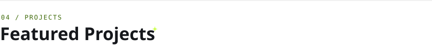
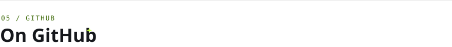
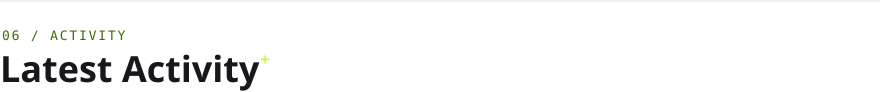

<!-- Images in assets/ are generated by scripts/render.mjs; the GitHub cards and
     the activity list are refreshed daily by .github/workflows/profile.yml. -->

<a href="https://nilupulperera.dev">
  <picture>
    <source media="(prefers-color-scheme: dark)" srcset="assets/dark/header.svg">
    
  </picture>
</a>

  <a href="https://nilupulperera.dev"><picture><source media="(prefers-color-scheme: dark)" srcset="assets/dark/btn-portfolio.svg"></picture></a>
  <a href="https://linkedin.com/in/hasunnilupul"><picture><source media="(prefers-color-scheme: dark)" srcset="assets/dark/btn-linkedin.svg"></picture></a>
  <a href="https://nilupulperera.dev/assets/Nilupul-Perera-Resume.pdf"><picture><source media="(prefers-color-scheme: dark)" srcset="assets/dark/btn-resume.svg"></picture></a>

 

<picture>
  <source media="(prefers-color-scheme: dark)" srcset="assets/dark/title-about.svg">
  
</picture>

I'm Nilupul, a frontend-focused **Senior Software Engineer** who enjoys turning complex requirements into fast, accessible interfaces. I've spent **4+ years** building production React, Next.js, Vue and Angular applications — from WCAG-compliant UI kits to real-time, WebSocket-driven dashboards and geospatial data visualizations.

- 🛠️ &nbsp;Currently a Senior Software Engineer at **Focalid Technologies**, Sri Lanka
- ☁️ &nbsp;**AWS Certified Developer – Associate**
- ✍️ &nbsp;I write on [Medium](https://hasunnilupul.medium.com/) and [DEV](https://dev.to/hasunnilupul)
- 💬 &nbsp;Ask me about **React, Next.js, Vue, TypeScript, accessibility and real-time UIs**

 

<picture>
  <source media="(prefers-color-scheme: dark)" srcset="assets/dark/title-experience.svg">
  
</picture>

<picture>
  <source media="(prefers-color-scheme: dark)" srcset="assets/dark/experience.svg">
  
</picture>

  

<picture>
  <source media="(prefers-color-scheme: dark)" srcset="assets/dark/title-stack.svg">
  
</picture>

<picture>
  <source media="(prefers-color-scheme: dark)" srcset="assets/dark/stack.svg">
  
</picture>

  

<picture>
  <source media="(prefers-color-scheme: dark)" srcset="assets/dark/title-projects.svg">
  
</picture>

  <a href="https://micro-loan-manager.nilupulperera.dev"><picture><source media="(prefers-color-scheme: dark)" srcset="assets/dark/project-1.svg"></picture></a>
  <a href="https://github.com/hasunnilupul/kiln"><picture><source media="(prefers-color-scheme: dark)" srcset="assets/dark/project-2.svg"></picture></a>

  <a href="https://github.com/hasunnilupul/personal-finance-tracker"><picture><source media="(prefers-color-scheme: dark)" srcset="assets/dark/project-3.svg"></picture></a>
  <a href="https://github.com/hasunnilupul/web-image-compressor"><picture><source media="(prefers-color-scheme: dark)" srcset="assets/dark/project-4.svg"></picture></a>

<a href="https://nilupulperera.dev/projects"><b>See all projects ↗</b></a>

<picture>
  <source media="(prefers-color-scheme: dark)" srcset="assets/dark/title-github.svg">
  
</picture>

<picture>
  <source media="(prefers-color-scheme: dark)" srcset="assets/dark/stats.svg">
  
</picture>

<picture>
  <source media="(prefers-color-scheme: dark)" srcset="assets/dark/calendar.svg">
  
</picture>

  <picture><source media="(prefers-color-scheme: dark)" srcset="assets/dark/languages.svg"></picture>
  <a href="https://github.com/hasunnilupul?tab=repositories"><picture><source media="(prefers-color-scheme: dark)" srcset="assets/dark/recent.svg"></picture></a>

<picture>
  <source media="(prefers-color-scheme: dark)" srcset="assets/dark/snake.svg">
  
</picture>

  

<picture>
  <source media="(prefers-color-scheme: dark)" srcset="assets/dark/title-activity.svg">
  
</picture>

<!-- ACTIVITY:START -->
<!-- ACTIVITY:END -->

 

<picture>
  <source media="(prefers-color-scheme: dark)" srcset="assets/dark/title-connect.svg">
  
</picture>

Got a project, a role or just want to say hi? My inbox is open.

  <a href="https://nilupulperera.dev"><picture><source media="(prefers-color-scheme: dark)" srcset="assets/dark/btn-portfolio.svg"></picture></a>
  <a href="mailto:nilupulpere@gmail.com"><picture><source media="(prefers-color-scheme: dark)" srcset="assets/dark/btn-email.svg"></picture></a>
  <a href="https://linkedin.com/in/hasunnilupul"><picture><source media="(prefers-color-scheme: dark)" srcset="assets/dark/btn-linkedin.svg"></picture></a>
  <a href="https://hasunnilupul.medium.com/"><picture><source media="(prefers-color-scheme: dark)" srcset="assets/dark/btn-medium.svg"></picture></a>
  <a href="https://dev.to/hasunnilupul"><picture><source media="(prefers-color-scheme: dark)" srcset="assets/dark/btn-devto.svg"></picture></a>

<picture>
  <source media="(prefers-color-scheme: dark)" srcset="assets/dark/footer.svg">
  
</picture>
